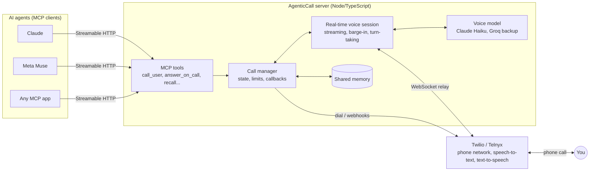

# AgenticCall

**An MCP server that lets AI agents phone you and hold a natural, real-time voice conversation.**

Your AI agent (Claude, Meta Muse, or any app that supports MCP connectors) decides something needs your
attention, such as a meeting change, an urgent email or a decision it's blocked on, and **calls your real
phone**. You talk to it like a person. Ask it something mid-call ("what's on my calendar Friday?") and it
checks with your agent's own tools while you keep talking. When you hang up, the agent gets a summary,
your decisions and the full transcript, and gets to work.

```text
📞  "Hey Haider, it's Claude. Your 3pm with Dana got moved to 2. Want me to accept?"
🙋  "Yeah, and what else is on my calendar tomorrow?"
📞  "Let me check... Pretty light: HackerRank at eleven, then the gym at eight."
🙋  "Cool, that's all."
📞  "Done, I accepted the 2pm. Talk soon!"            → agent receives decisions + transcript
```

**Stack:** TypeScript, Node.js, Model Context Protocol (Streamable HTTP and stdio), Twilio Voice and
ConversationRelay (Telnyx also supported), Claude Haiku 5.5 with Groq models as automatic backup,
WebSockets, Express, Docker, Railway.
**Size:** about 3,300 lines of TypeScript, plus about 1,200 lines of tests (26 tests, all offline).

---

## Highlights

- **Real-time, interruptible voice.** Replies stream to text-to-speech token by token, so the first
  word arrives in under a second. You can talk over it and it stops and listens.
- **A live bridge to your agent.** A fast voice model holds the conversation. Anything it can't answer
  itself goes to your agent mid-call through MCP, and the voice reads the answer back in its own words.
  Slow tasks get a time estimate and an offer to call you back when they're done.
- **Automatic callbacks.** If you hang up before a task finishes, the server calls you back with the
  result as soon as the agent submits it.
- **Shared long-term memory.** The voice saves facts you mention ("doesn't like Khamrah", "budget is
  $50") and loads them into every future call. Every connected AI can read and add to the same memory.
- **Works with many AIs and providers.** Any MCP-capable agent can connect (Claude, Muse, ChatGPT,
  Cursor and others). Voice runs on **Twilio** or **Telnyx**; the AI runs on **Claude Haiku** with
  **Groq** taking over automatically when it's rate-limited or unavailable.
- **Guardrails.**
  - It can only ever call one configured number.
  - Quiet hours, an hourly call limit, and only one active call at a time.
  - Twilio webhook signatures and Telnyx webhook signatures (or per-call secrets) are verified.
  - The MCP endpoint is token-protected.

## Architecture



**How a call flows**

1. The agent calls `call_user` with an opening line, a briefing (facts it may need) and a goal.
2. The server dials through Twilio or Telnyx. When you answer, the provider opens a **ConversationRelay**
   WebSocket: your speech arrives as text, and the server streams reply text back to be spoken.
3. A fast voice model runs the conversation, using the briefing plus everything saved in shared memory.
4. When you ask for something only the agent can do, the voice calls an internal `ask_agent` tool and
   covers the gap ("Let me check."). The agent, waiting on `wait_for_reply`, receives the request with
   the recent conversation, uses its own tools (email, calendar, web...), and replies with
   `answer_on_call`.
5. When you hang up, the agent receives a summary, your decisions, follow-ups and the transcript.

## Engineering notes

These came out of many live test calls, each followed by reading the transcript and fixing what went
wrong:

- **Turn-taking.**
  - Stops a reply when the model starts answering on your behalf after asking you a question.
  - Doesn't answer a bare "okay" after an open-ended question; it waits for you to go on.
  - Merges sentences the speech recognizer split in two, so they get one reply.
  - Ignores provider "interrupts" that arrive after a reply has already finished playing.
- **Hanging up safely.** It only hangs up when you've said goodbye or asked it to, never on its own,
  and talking over a goodbye cancels the hang-up.
- **Robust tool calls across models.**
  - The first sentence is held back until it's complete, so a reply that turns into a broken tool call
    is retried without tools instead of leaving you with half a word.
  - Tool-call IDs are generated on the server, so models that reuse IDs can't break the history.
  - Tool results are always placed directly after their call.
- **Reliability under rate limits.**
  - Rotates across several models when one is rate-limited, waiting as long as the provider asks.
  - Retries quietly rather than repeating "sorry".
  - Never hangs up just because the model had a short outage.
- **Cost control.**
  - A short per-turn prompt.
  - A history window that moves in fixed steps, so Claude's prompt cache keeps working.
  - Older turns are trimmed in a way that never loses the agent's answers or what you said.
- **Speech-safe output.** Markdown and stage directions like "[No response needed]" are stripped before
  speaking. Long answers are capped at sentence boundaries, and multi-part answers are announced and
  covered in full.
- **Operations.**
  - On redeploy, the server waits for live calls to finish before shutting down.
  - Phone providers are optional: with none set up, the server still runs and calls are just off.
  - Errors are recorded in each call's transcript so they can be diagnosed without server logs.

## MCP tools

| Tool | Purpose |
|---|---|
| `call_user` | Ring the user with an opening line, a briefing and a goal. In real-time mode, returns mid-call requests and then the outcome. |
| `wait_for_reply` | Keep listening for mid-call requests (`agent_requests`) or the end-of-call outcome. |
| `answer_on_call` | Answer a mid-call request; the voice tells the user straight away. |
| `acknowledge_request` | Give a time estimate for slow work; long estimates offer the user a call back. |
| `say_on_call` / `end_call` | Speak on the call directly, or say goodbye and hang up. |
| `remember` / `recall` / `forget` | Shared long-term memory about the user, used on every call. |
| `get_call` / `list_calls` | Call status, outcomes and transcripts. |
| `send_sms` | Text the user (Twilio). |

There is also a **turn-by-turn** mode where the agent itself answers every turn; it's slower, but needs
no voice-model key.

## Quick start

1. **Phone provider.** Get a Twilio number (see Twilio setup below) or a Telnyx one ([`docs/TELNYX.md`](docs/TELNYX.md)).
2. **Voice model key.** Add `ANTHROPIC_API_KEY` (Claude Haiku), plus `GROQ_API_KEY` as a free backup.
3. **Configure.**
   ```bash
   cp .env.example .env
   ```
   Fill in the provider credentials, `USER_PHONE_NUMBER`, `PUBLIC_BASE_URL` and `MCP_AUTH_TOKEN`.
   Generate the token with:
   ```bash
   openssl rand -hex 32
   ```
4. **Deploy** somewhere with public HTTPS. There's a step-by-step [Railway guide](docs/RAILWAY.md) and a
   `Dockerfile` for anywhere else. For persistent memory, mount a volume at `/app/data`.
5. **Connect your AI.** Add a custom connector with `https://<your-host>/mcp?token=<MCP_AUTH_TOKEN>`.
   - **Claude:** Settings → Connectors → Add custom connector.
   - **Meta Muse:** Custom Connector.
   - **Claude Code:**
     ```bash
     claude mcp add --transport http agentic-call https://<your-host>/mcp --header "Authorization: Bearer <MCP_AUTH_TOKEN>"
     ```
6. **Tell your agent when to call**, for example:
   > Every hour, check my email and calendar. If anything is urgent or time-sensitive, call me with
   > `call_user`; text me for things that can wait.

### Twilio setup
1. Create an account at [twilio.com](https://www.twilio.com) and buy a voice-capable number.
2. Copy your **Account SID** and **Auth Token** into `TWILIO_ACCOUNT_SID`, `TWILIO_AUTH_TOKEN` and
   `TWILIO_FROM_NUMBER`.
3. On a trial account, also verify your own number under *Verified Caller IDs*.

You don't need to configure webhooks on the number: the server passes its URLs to Twilio on every call.

## Configuration

All options are in [`.env.example`](.env.example). The most useful:

| Variable | Default | Notes |
|---|---|---|
| `ANTHROPIC_API_KEY` / `ANTHROPIC_MODEL` | unset / `claude-haiku-5-5` | Main voice model. |
| `GROQ_API_KEY` / `GROQ_MODEL` / `GROQ_FALLBACK_MODEL` | unset / `openai/gpt-oss-120b` / `openai/gpt-oss-120b,openai/gpt-oss-20b` | Backup voice models, rotated on rate limits. |
| `PHONE_PROVIDER` | Telnyx if set up, else Twilio | `twilio` or `telnyx`. |
| `MEMORY_FILE` | `data/memory.json` | Shared memory; use a persistent volume. `off` disables it. |
| `QUIET_HOURS` / `TIMEZONE` | unset / `America/New_York` | For example `22:00-07:00`; only `critical` calls ring then. |
| `MAX_CALLS_PER_HOUR` | `6` | `critical` calls bypass this. |
| `ANSWERING_MACHINE_DETECTION` | `true` | Voicemail detection with an SMS fallback (Twilio); turn off to save cost. |
| `TELNYX_VOICE` | `Azure.en-US-BrianMultilingualNeural` | Voice on Telnyx calls. |
| `AGENT_ANSWER_TIMEOUT_SECONDS` / `CALLBACK_THRESHOLD_SECONDS` | `45` / `60` | When to say "it's taking longer" and when to offer a call back. |

## Development

```bash
npm install
```

```bash
npm test
```

```bash
npm run dev
```

The tests run complete simulated calls offline:
- signed Twilio and Telnyx webhooks, and a fake ConversationRelay WebSocket;
- a real MCP client and a scripted voice model;
- mid-call agent requests, callbacks, interruptions, rate-limit recovery, shared memory and turn-taking.

To place a real call through a deployed server and play the agent from your terminal:

```bash
npm run test-call -- https://<your-host>/mcp <MCP_AUTH_TOKEN>
```

## Limitations

- Call state lives in memory, so run a single instance. Shared memory persists to disk.
- Phone minutes are billed by the provider (a few cents per call). The voice model costs well under a
  cent per call with prompt caching.
- Agents only learn what they ask for (MCP is pull-based), so an agent has to keep listening with
  `wait_for_reply` during a call to answer mid-call requests.

## License

MIT
